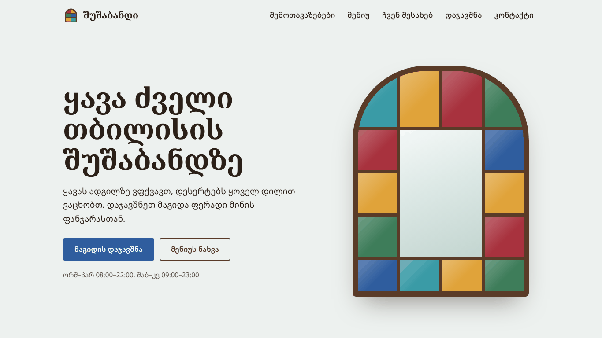
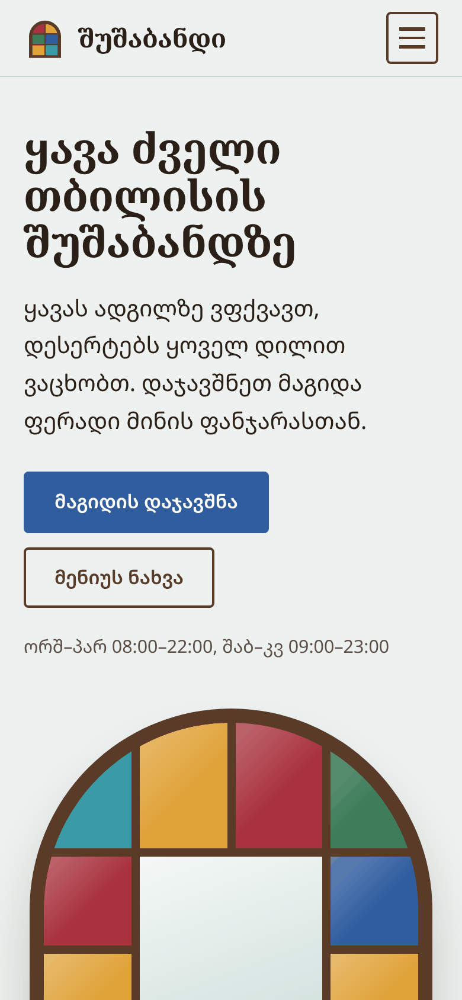
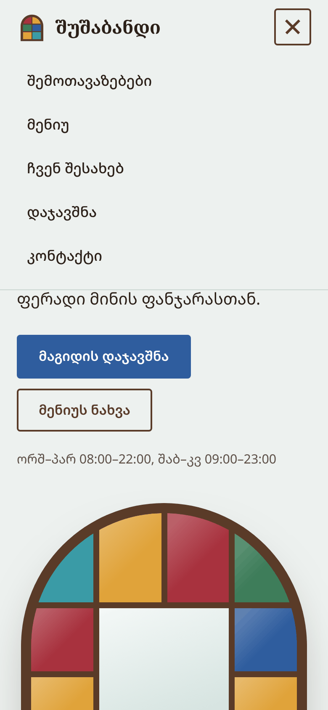
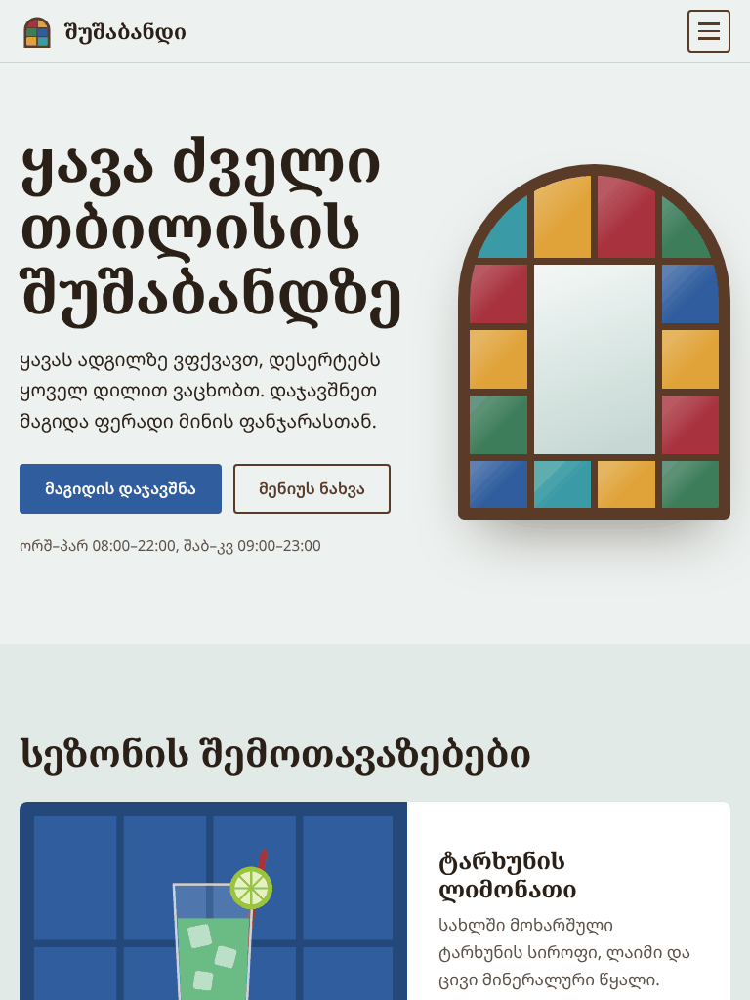
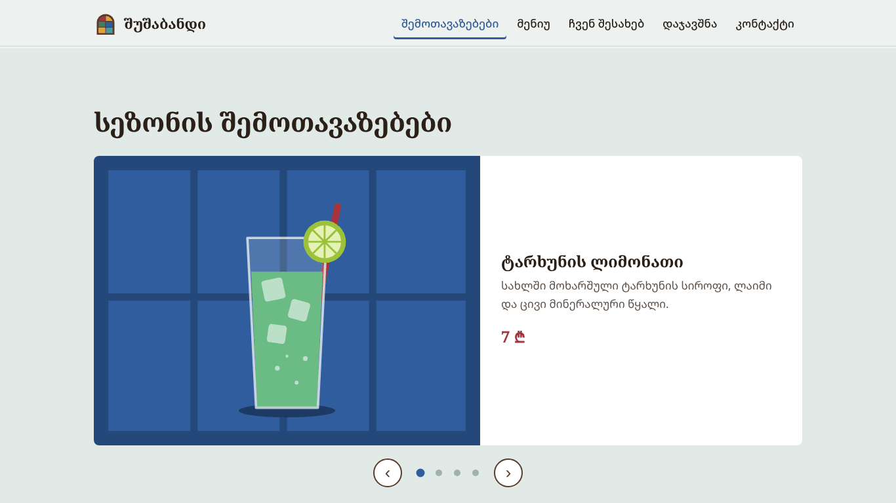
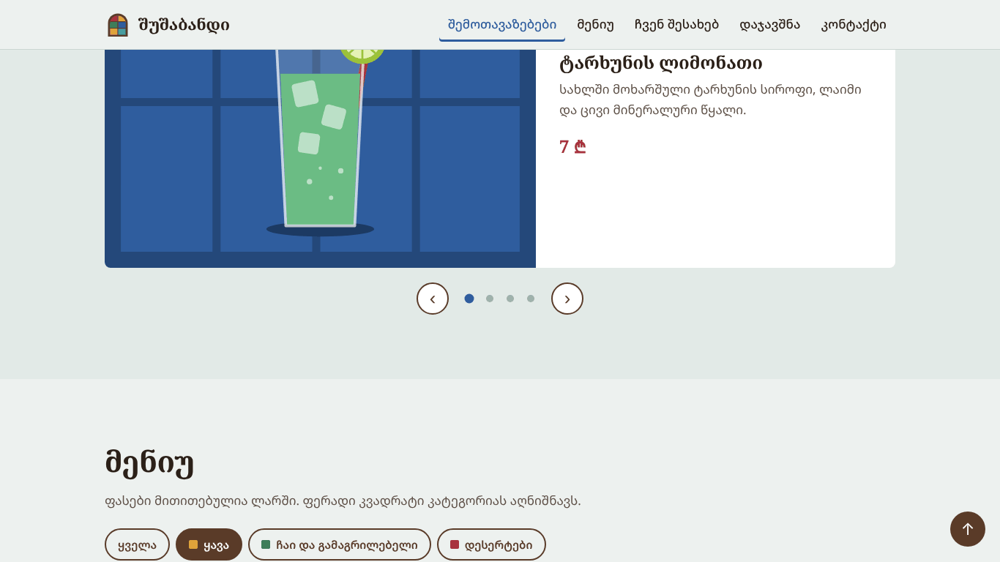
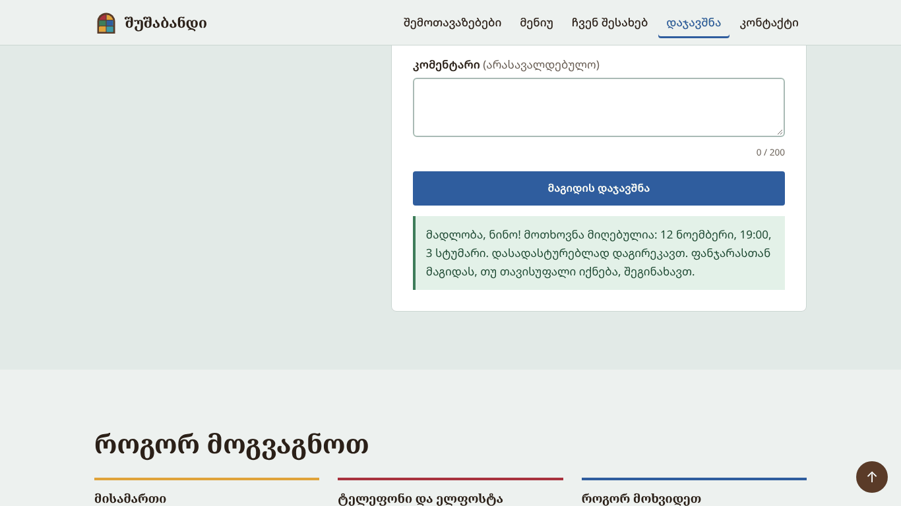

# „შუშაბანდი“ — ყავახანის ვებგვერდი

Front-end პროგრამირების პრაქტიკული პროექტი (მოდული 06.1.1.9).
ავტორი: ალექსანდრე

**ლაივ ვერსია:** https://USERNAME.github.io/shushabandi/



## სარჩევი

1. [სამუშაო გეგმა](#1-სამუშაო-გეგმა)
2. [პროექტის აღწერა](#2-პროექტის-აღწერა)
3. [ტექნოლოგიები და ინსტრუმენტები](#3-ტექნოლოგიები-და-ინსტრუმენტები)
4. [ფაილების სტრუქტურა](#4-ფაილების-სტრუქტურა)
5. [გვერდის არქიტექტურა (HTML5)](#5-გვერდის-არქიტექტურა-html5)
6. [სტილი და რესპონსივობა (CSS3)](#6-სტილი-და-რესპონსივობა-css3)
7. [JavaScript ფუნქციონალი](#7-javascript-ფუნქციონალი)
8. [ვერსიების კონტროლი (Git/GitHub)](#8-ვერსიების-კონტროლი-gitgithub)
9. [ოპტიმიზაცია](#9-ოპტიმიზაცია)
10. [პრობლემები და მათი გადაწყვეტა](#10-პრობლემები-და-მათი-გადაწყვეტა)
11. [ტესტირება](#11-ტესტირება)
12. [გაშვება](#12-გაშვება)
13. [ეკრანის ანაბეჭდები](#13-ეკრანის-ანაბეჭდები)
14. [ლიცენზიები](#14-ლიცენზიები)

## 1. სამუშაო გეგმა

### მიზანი

შევქმნა რესპონსიული ვებგვერდი გამოგონილი ყავახანისთვის. მომხმარებელი საიტზე ნახავს მენიუს და სეზონის შემოთავაზებებს და ონლაინ დაჯავშნის მაგიდას. საიტი სწორად უნდა მუშაობდეს მობილურზე, პლანშეტსა და დესკტოპზე.

### ეტაპები და ვადები

| № | ეტაპი | შედეგი | ვადა |
|---|-------|--------|------|
| 1 | დაგეგმვა | თემა, გვერდის სტრუქტურა, ფერები, შრიფტები, სამუშაო გეგმა | 5 ნოემბერი |
| 2 | HTML5 მარკირება | სემანტიკური სტრუქტურა და მთელი ტექსტური შიგთავსი | 5 ნოემბერი |
| 3 | CSS3 სტილი და რესპონსივობა | Flexbox, Grid, მედიამოთხოვნები | 5 ნოემბერი |
| 4 | JavaScript ფუნქციონალი | მობილური მენიუ, სლაიდერი, მენიუს ფილტრი, ფორმის ვალიდაცია | 5 ნოემბერი |
| 5 | ოპტიმიზაცია და ტესტირება | ვალიდაცია, შემოწმება სამ ეკრანზე, შეცდომების გასწორება | 5 ნოემბერი |
| 6 | დოკუმენტაცია და პრეზენტაცია | README.md, სლაიდები | 6 ნოემბერი, წარდგენამდე |

### რისკები

| რისკი | ალბათობა | როგორ ვამცირებ |
|-------|----------|----------------|
| ქართული შრიფტი ნელა იტვირთება ან სხვა კომპიუტერზე არასწორად ჩანს | საშუალო | შრიფტები პროექტშივეა, მხოლოდ ქართული და ლათინური ნაწილით; `font-display: swap`. |
| განლაგება ირღვევა პატარა ეკრანზე | საშუალო | mobile-first მიდგომა; შემოწმება 375, 768 და 1366 პიქსელ სიგანეზე. |
| JavaScript-ის შეცდომა ან გათიშული JavaScript | დაბალი | მთელი შიგთავსი JavaScript-ის გარეშეც ჩანს; ფორმას HTML5 ვალიდაციის ატრიბუტებიც აქვს. |
| კოდის დაკარგვა | დაბალი | Git და GitHub, ხშირი ქომითები. |
| ლაბორატორიაში ინტერნეტი არ მუშაობს | დაბალი | საიტი გარე სერვისებზე დამოკიდებული არ არის და ინტერნეტის გარეშეც იხსნება. |

### რესურსები და მეთოდები

- **ტექნოლოგიები:** HTML5, CSS3 (Flexbox, Grid, მედიამოთხოვნები), JavaScript (ES6), Git/GitHub.
- **ინსტრუმენტები:** VS Code, Live Server, Chrome DevTools (Device Mode, Lighthouse), W3C Markup Validator.
- **დიზაინის მასალები:** Noto Sans Georgian და Noto Serif Georgian შრიფტები (SIL Open Font License), საკუთარი SVG ილუსტრაციები, ფერთა პალიტრა ძველი თბილისის შუშაბანდების ფერადი მინიდან.
- **მეთოდები:** mobile-first, პროგრესული გაუმჯობესება (progressive enhancement), Conventional Commits, ცალკე ბრენჩი თითოეული დიდი ნაწილისთვის.

### როლები და პასუხისმგებლობები

პროექტს მარტო ვასრულებ, ამიტომ ყველა როლი ჩემზეა. თითოეულ როლს თავისი ეტაპი შეესაბამება:

| როლი | პასუხისმგებლობა | ეტაპი |
|------|-----------------|-------|
| პროექტის მენეჯერი | გეგმა, ვადები, რისკების კონტროლი | 1, 6 |
| UI დიზაინერი | ფერები, შრიფტები, განლაგება, ილუსტრაციები | 1, 3 |
| Front-end დეველოპერი | HTML, CSS, JavaScript | 2, 3, 4 |
| ტესტერი | ვალიდაცია, შემოწმება სხვადასხვა ეკრანზე და ბრაუზერში | 5 |
| დოკუმენტაციის ავტორი | README.md, პრეზენტაცია | 6 |

**კომუნიკაცია:** პედაგოგი ამ პროექტში დამკვეთის როლშია — კითხვებს კონსულტაციაზე ვუსვამ, შედეგს კი პრეზენტაციით წარვადგენ. სამუშაოს პროგრესი GitHub-ის ქომითების ისტორიაში ჩანს.

## 2. პროექტის აღწერა

„შუშაბანდი“ გამოგონილი ყავახანის ერთგვერდიანი საიტია. სახელი და დიზაინი ძველი თბილისის შუშაბანდებიდან მოდის: მთავარ ეკრანზე ფერადი მინის თაღოვანი ფანჯარაა, რომელიც სურათის გარეშე, მხოლოდ CSS Grid-ითაა აწყობილი. იგივე ფერები მთელ საიტზე მეორდება: მენიუში კატეგორიას აღნიშნავს, კონტაქტებში კი ბლოკებს ჰყოფს.

საიტზე მომხმარებელს შეუძლია:

- ნახოს სეზონის შემოთავაზებები სლაიდერში;
- გაფილტროს მენიუ კატეგორიების მიხედვით (ყავა, ჩაი და გამაგრილებელი, დესერტები);
- გაიგოს სამუშაო საათები და მისამართი;
- დაჯავშნოს მაგიდა ფორმით, რომელიც მონაცემებს ქართული შეტყობინებებით ამოწმებს.

## 3. ტექნოლოგიები და ინსტრუმენტები

| ტექნოლოგია / ინსტრუმენტი | სად და რისთვის გამოვიყენე |
|--------------------------|---------------------------|
| HTML5 | სემანტიკური სტრუქტურა, ფორმა, SVG ლოგო |
| CSS3 (Flexbox, Grid) | განლაგება, რესპონსივობა, ანიმაცია |
| JavaScript (ES6) | მენიუ, სლაიდერი, ფილტრი, ფორმის ვალიდაცია |
| Git, GitHub | ვერსიების კონტროლი, ბრენჩები, GitHub Pages |
| VS Code + Live Server | კოდის წერა და ლოკალური სერვერი |
| Chrome DevTools | Device Mode (რესპონსივობა), Lighthouse (სიჩქარე) |
| W3C Nu Html Checker, html-validate | HTML-ისა და CSS-ის ვალიდაცია |
| SVGO | SVG ფაილების შემცირება |
| Playwright | ფუნქციონალის ავტომატური შემოწმება ბრაუზერში |

ფრეიმვორკი არ გამომიყენებია: მთელი კოდი სუფთა HTML, CSS და JavaScript-ია.

## 4. ფაილების სტრუქტურა

```
shushabandi/
├── index.html            მთავარი (ერთადერთი) გვერდი
├── css/
│   └── style.css         ყველა სტილი, mobile-first
├── js/
│   ├── nav.js            მობილური მენიუ, მიმდინარე სექციის მონიშვნა
│   ├── slider.js         სლაიდერი
│   ├── menu-filter.js    მენიუს ფილტრი
│   ├── booking-form.js   დაჯავშნის ფორმა და ვალიდაცია
│   └── ui.js             „ზემოთ ასვლის“ ღილაკი, წელი ფუტერში
├── images/               SVG ილუსტრაციები და favicon
├── fonts/                ქართული შრიფტები (woff2) და მათი ლიცენზია
├── docs/screenshots/     ეკრანის ანაბეჭდები README-სთვის
├── tests/
│   └── site_checks.py    ავტომატური შემოწმება (Playwright)
└── README.md
```

## 5. გვერდის არქიტექტურა (HTML5)

საიტი ერთგვერდიანია, სექციებს შორის ნავიგაცია ბმულებით (`#menu`, `#booking` …) ხდება.

```
header.site-header
  └─ nav.main-nav        (ლოგო, ჰამბურგერ-ღილაკი, ბმულები)
main#main
  ├─ section.hero        (h1, ღილაკები, ფერადი ფანჯარა)
  ├─ section#specials    (სლაიდერი: figure + figcaption)
  ├─ section#menu        (ფილტრი, ul.menu-grid)
  ├─ section#about       (ტექსტი, aside — სამუშაო საათები, dl)
  ├─ section#booking     (form, label, input, select, textarea)
  └─ section#contact     (address, ტელეფონი, ელფოსტა)
footer.site-footer
```

გამოყენებული სემანტიკური ელემენტები: `header`, `nav`, `main`, `section`, `aside`, `footer`, `figure`, `figcaption`, `address`, `time`, `dl/dt/dd`, `form`, `label`.

- სათაურები იერარქიულია: ერთი `h1`, ყოველ სექციას თავისი `h2`, შიგნით `h3`.
- თითოეული სექცია სათაურთანაა დაკავშირებული `aria-labelledby`-ით.
- ყველა სურათს აქვს `alt` ტექსტი, `width` და `height`.
- გვერდის დასაწყისში არის „მთავარ შიგთავსზე გადასვლის“ ბმული კლავიატურით მოსარგებლეთათვის.
- `lang="ka"`, `meta description` და `theme-color` საძიებო სისტემებისა და მობილური ბრაუზერისთვის.

## 6. სტილი და რესპონსივობა (CSS3)

### mobile-first და წყვეტის წერტილები

ძირითადი სტილი მობილურისთვისაა დაწერილი, დიდი ეკრანებისთვის კი `min-width` მედიამოთხოვნები ემატება:

| ეკრანი | სიგანე | რა იცვლება |
|--------|--------|------------|
| მობილური | 768px-მდე | ყველაფერი ერთ სვეტად, ჰამბურგერ-მენიუ |
| პლანშეტი | 768px-დან | hero ორ სვეტად, მენიუ ორ სვეტად, კონტაქტები სამ სვეტად, ფორმის ველები ერთ რიგში |
| დესკტოპი | 1024px-დან | ნავიგაცია ყოველთვის ჩანს, „ჩვენ შესახებ“ და ფორმა ორ სვეტად |

### სად Flexbox და სად Grid

- **Flexbox** (ერთი მიმართულება): ჰედერი, ნავიგაცია, ღილაკები, მენიუს სათაური-ფასის რიგი, სლაიდერის ღილაკები, ფუტერი.
- **Grid** (ორი მიმართულება): hero, ფერადი ფანჯარა (4 სვეტი × 5 რიგი; შუა მინა `grid-column: span 2` და `grid-row: span 3`), მენიუს ბადე, „ჩვენ შესახებ“, ფორმა, კონტაქტები.

### სხვა CSS3 შესაძლებლობები

- `clamp()` — სათაურის ზომა ეკრანის სიგანესთან ერთად შეუფერხებლად იცვლება.
- `aspect-ratio` — ფანჯარა ყოველთვის 3:4 პროპორციას ინარჩუნებს.
- `@keyframes` — ფანჯრის მინები ჩატვირთვისას ზემოდან ქვემოთ „ნათდება“.
- `scroll-snap` — JavaScript-ის გარეშე სლაიდები თითით გადაიხვევა.
- `prefers-reduced-motion` — თუ მომხმარებელს ანიმაცია გამორთული აქვს, მოძრაობა ითიშება.
- `:focus-visible` — კლავიატურით ნავიგაციისას ფოკუსი კარგად ჩანს.

### ფერები

კოდის სიმარტივისთვის ფერები პირდაპირ hex მნიშვნელობებითაა ჩაწერილი (CSS ცვლადების გარეშე), კლასების სახელები კი მარტივი და ერთდონიანია (`.menu-item`, `.slider-btn`).

| ფერი | hex | სად |
|------|-----|-----|
| მუქი კაკალი | `#2B2018` | ტექსტი, ფუტერი |
| კაკალი | `#5A3B28` | ფანჯრის ჩარჩო, „ჩვენ შესახებ“ |
| ბათქაში | `#EDF1EF` | ფონი |
| კობალტი | `#2F5D9E` | მთავარი ღილაკი, ფოკუსი |
| ლალისფერი | `#A8323E` | ფასი, შეცდომა |
| ქარვისფერი | `#E0A33A` | ყავის კატეგორია |
| ბოთლისფერი მწვანე | `#3E7D5A` | სასმელების კატეგორია |
| ფირუზისფერი | `#3A9BA6` | ფანჯრის მინა |

## 7. JavaScript ფუნქციონალი

თითოეული ფუნქცია ცალკე ფაილშია. ყველა ფაილი `defer`-ით იტვირთება, ამიტომ გვერდის გამოჩენას არ აყოვნებს.

| ფაილი | რას აკეთებს |
|-------|-------------|
| `nav.js` | ჰამბურგერ-მენიუს გახსნა და დახურვა (`aria-expanded`); მენიუ იხურება ბმულზე დაჭერით, Escape-ით და გარეთ დაჭერით. მენიუში მონიშნულია ის სექცია, რომელსაც მომხმარებელი უყურებს. |
| `slider.js` | წინა/შემდეგი ღილაკები, წერტილები, ისრების ღილაკები, თითით გადაფურცვლა, ავტომატური გადართვა 5 წამში ერთხელ. მაუსის მიტანისას ან ფოკუსისას ჩერდება. |
| `menu-filter.js` | მენიუს ფილტრი კატეგორიებით. ოთხ ღილაკს ერთი listener ემსახურება (event delegation); ეკრანის წამკითხველი გაიგებს, რამდენი პოზიცია დარჩა. |
| `booking-form.js` | ფორმის ვალიდაცია ქართული შეტყობინებებით: სახელი, მობილურის ნომერი (`5XX XX XX XX`, `+995`-ითაც), წარსული თარიღისა და დღეს უკვე გასული საათის აკრძალვა, კომენტარის სიმბოლოების მთვლელი, დადასტურების ტექსტი. |
| `ui.js` | „ზემოთ ასვლის“ ღილაკი და მიმდინარე წელი ფუტერში. |

### პროგრესული გაუმჯობესება

საიტი JavaScript-ის გარეშეც მუშაობს: ნავიგაციის ბმულები ჩანს, სლაიდები თითით ან მაუსით გადაიხვევა, მენიუ სრულადაა ნაჩვენები, ფორმას კი ბრაუზერის ჩაშენებული ვალიდაცია (`required`, `minlength`) ამოწმებს. JavaScript `<html>` ელემენტს `js` კლასს ამატებს და მხოლოდ ამის შემდეგ მალავს მობილურ მენიუს.

### უსაფრთხოება

დადასტურების შეტყობინება `textContent`-ით იწერება და არა `innerHTML`-ით, ამიტომ სახელის ველში ჩაწერილი HTML ან სკრიპტი ტექსტად გამოჩნდება და არ შესრულდება.

## 8. ვერსიების კონტროლი (Git/GitHub)

- თითოეული დიდი ნაწილი ცალკე ბრენჩზე კეთდებოდა და `main`-ში `--no-ff` შერწყმით შედიოდა, რომ ისტორიაში ეტაპები კარგად ჩანდეს.
- ქომითების შეტყობინებები [Conventional Commits](https://www.conventionalcommits.org/) ფორმატითაა: `feat:` (ახალი ფუნქცია), `fix:` (შეცდომის გასწორება), `perf:` (ოპტიმიზაცია), `docs:`, `test:`, `chore:`.

| ბრენჩი | რა შეიცავს |
|--------|------------|
| `main` | სტრუქტურა, სამუშაო გეგმა, დოკუმენტაცია, ტესტები |
| `feature/layout` | HTML მარკირება და CSS |
| `feature/interactivity` | JavaScript-ის ხუთი ფაილი |
| `perf/optimization` | ოპტიმიზაცია და ვალიდაციის შეცდომების გასწორება |

ისტორიის სანახავად:

```bash
git log --oneline --graph
```

## 9. ოპტიმიზაცია

### გაზომილი შედეგი (Lighthouse 13, მობილურის რეჟიმი)

| მაჩვენებელი | ოპტიმიზაციამდე | ოპტიმიზაციის შემდეგ |
|-------------|----------------|---------------------|
| Performance | 93 | 100 |
| Cumulative Layout Shift | 0.155 | 0 |
| Accessibility | 100 | 100 |
| Best Practices | 100 | 100 |
| SEO | 100 | 100 |

დესკტოპის რეჟიმში ოთხივე კატეგორია 100-ია. გაზომვა ლოკალურ სერვერზე ჩატარდა.

### რა გავაკეთე

1. **შრიფტების წინასწარ ჩატვირთვა** (`<link rel="preload">`) — პირველ ეკრანზე საჭირო ორი ქართული შრიფტი CSS-ზე ადრე იწყებს ჩატვირთვას. ამან განლაგების „ხტომა“ (CLS) 0.155-დან 0-მდე შეამცირა.
2. **შრიფტები პროექტშივეა** — Google Fonts-ზე დამატებითი მოთხოვნა არ იგზავნება; მხოლოდ ქართული და ლათინური ნაწილია (`unicode-range`), ცვლადი წონით (ერთი ფაილი ყველა სისქისთვის).
3. **SVG ილუსტრაციები** ფოტოების ნაცვლად — ოთხი სლაიდის სურათი ჯამში 6 KB-ზე ნაკლებია. SVGO-მ ზომა 7.6 KB-დან 5.7 KB-მდე (25%-ით) შეამცირა.
4. **`loading="lazy"`** — სლაიდერის მეორე-მეოთხე სურათი მხოლოდ საჭიროებისას იტვირთება.
5. **`width` და `height` ყველა სურათზე** — ბრაუზერი ადგილს წინასწარ იტოვებს და გვერდი არ „ხტება“.
6. **`defer` სკრიპტებზე** — JavaScript HTML-ის დამუშავებას არ ბლოკავს.
7. **IntersectionObserver scroll-ის მოვლენის ნაცვლად** — „ზემოთ ასვლის“ ღილაკი და მიმდინარე სექციის მონიშვნა scroll-ის ყოველ მოძრაობაზე კოდს არ უშვებს.
8. **სლაიდერი ტყუილად არ მუშაობს** — ავტომატური გადართვა ჩერდება, როცა სლაიდერი ეკრანს მიღმაა ან ბრაუზერის ჩანართი არააქტიურია.
9. **event delegation** — მენიუს ფილტრის ოთხ ღილაკს ერთი listener ემსახურება.
10. **ფრეიმვორკის გარეშე** — მთელი გვერდი შრიფტებიანად დაახლოებით 235 KB-ია, შრიფტების გარეშე კი 70 KB-ზე ნაკლები.

CSS და JavaScript განზრახ არ არის მინიფიცირებული: სასწავლო პროექტში კოდის წაკითხვადობა უფრო მნიშვნელოვანია, Lighthouse-ის მიხედვით კი დანაზოგი მხოლოდ 9 KB იქნებოდა. GitHub Pages ფაილებს ისედაც შეკუმშულად (gzip) აწვდის.

## 10. პრობლემები და მათი გადაწყვეტა

### ტესტირებისას აღმოჩენილი

| პრობლემა | მიზეზი | გადაწყვეტა |
|----------|--------|------------|
| მობილურზე ჩატვირთვისას ფანჯარა ქვემოთ „ხტებოდა“ (CLS 0.155) | ქართული შრიფტი გვიან იტვირთებოდა, ტექსტი სხვანაირად იყოფოდა სტრიქონებად და ფანჯარას ქვემოთ სწევდა | შრიფტების `preload` → CLS 0 |
| სლაიდერის ღილაკზე დაჭერის შემდეგ ავტომატური გადართვა ისევ ირთვებოდა, თუმცა მაუსი სლაიდერზე იყო | `restartAutoplay` ყოველთვის რთავდა ტაიმერს | ტაიმერი ერთი ფუნქციით (`updateAutoplay`) იმართება, რომელიც ყველა პირობას ამოწმებს |
| ტაიმერი მუშაობდა, როცა სლაიდერი არ ჩანდა | ავტომატური გადართვა არ ამოწმებდა, ჩანს თუ არა სლაიდერი | IntersectionObserver და `visibilitychange` |
| W3C ვალიდატორის შეცდომები | `h3` იყო `address`-ში; `aria-label` სიის ელემენტზე; `required` ისეთ `select`-ზე, რომელსაც ყოველთვის აქვს მნიშვნელობა | სათაური `address`-ის გარეთ გავიტანე; სლაიდები `role="group"` ელემენტებად გადავაკეთე; `required` მოვხსენი → 0 შეცდომა |

### დაგეგმვისას თავიდან აცილებული

| პრობლემა | მიზეზი | გადაწყვეტა |
|----------|--------|------------|
| JavaScript-ის გარეშე მობილურ მენიუში მოხვედრა შეუძლებელი იქნებოდა | მენიუ CSS-ით იმალება | მენიუ მხოლოდ მაშინ იმალება, როცა `<html>`-ს `js` კლასი აქვს |
| ბრაუზერის ჩაშენებული შეცდომები ინგლისურად გამოჩნდებოდა | ბრაუზერის ენა | `form.noValidate = true` და საკუთარი ქართული შეტყობინებები |
| ბმულზე დაჭერისას sticky ჰედერი სექციის სათაურს დაფარავდა | ჰედერი ეკრანის ზედა ნაწილშია მიმაგრებული | `scroll-margin-top: 72px` |

## 11. ტესტირება

| შემოწმება | შედეგი |
|-----------|--------|
| W3C Nu Html Checker (HTML და CSS) | 0 შეცდომა |
| html-validate | 0 შეცდომა |
| Lighthouse (მობილური და დესკტოპი) | ყველა კატეგორია 100 |
| ეკრანის სიგანეები | 375px, 768px, 1366px — ჰორიზონტალური გადახვევის გარეშე |
| ავტომატური შემოწმება (`tests/site_checks.py`) | 37 / 37 |
| კონსოლის შეცდომები | 0 |

ავტომატური შემოწმება ბრაუზერში ამოწმებს მობილურ მენიუს, სლაიდერს, ფილტრს, ფორმის ყველა შეცდომას, წარმატებულ დაჯავშნას და საიტის მუშაობას JavaScript-ის გარეშე. გაშვება:

```bash
pip install playwright
python -m playwright install chromium
python tests/site_checks.py
```

## 12. გაშვება

**ლოკალურად:** `index.html` გახსენით ბრაუზერში (ორჯერ დაწკაპუნებით) ან VS Code-ში Live Server-ით. ინტერნეტი არ არის საჭირო.

**GitHub Pages:** რეპოზიტორიუმში Settings → Pages → Source: „Deploy from a branch“ → `main` / `(root)` → Save. ერთ-ორ წუთში საიტი გაიხსნება მისამართზე `https://USERNAME.github.io/shushabandi/`.

## 13. ეკრანის ანაბეჭდები

| მობილური | მობილური მენიუ | პლანშეტი |
|----------|----------------|----------|
|  |  |  |

სლაიდერი:



მენიუს ფილტრი (ყავა):



დაჯავშნის დადასტურება:



## 14. ლიცენზიები

- შრიფტები: Noto Sans Georgian და Noto Serif Georgian, SIL Open Font License 1.1 (`fonts/OFL-LICENSE.txt`).
- ილუსტრაციები და კოდი: საკუთარი.
- ყავახანა, მისამართის ნომერი, ტელეფონი და ელფოსტა გამოგონილია და მხოლოდ სასწავლო მიზნით გამოიყენება.
